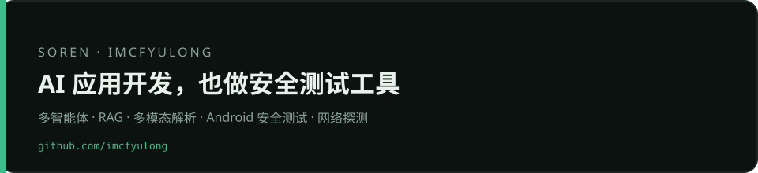
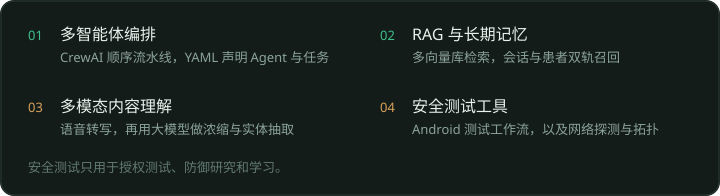
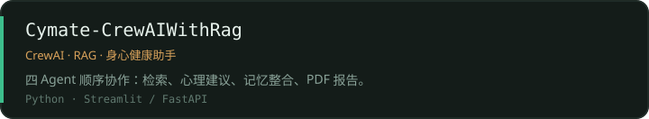
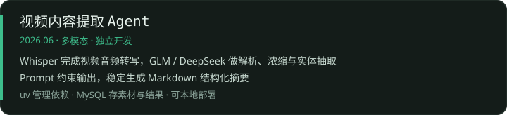
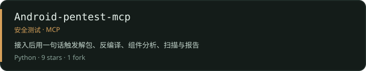
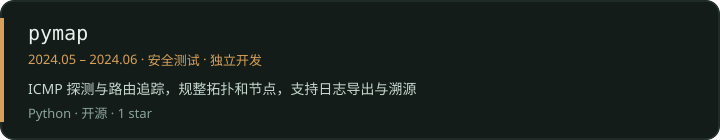
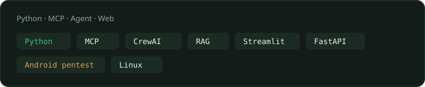
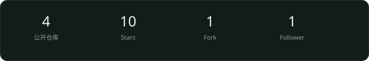
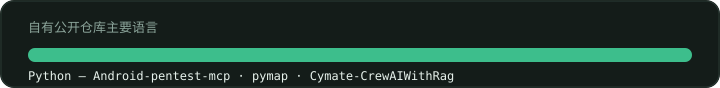
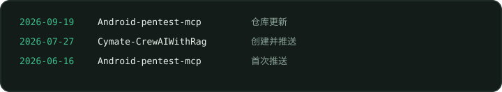

  

  

  

  

  

  

  

  

  

  

  

  

  

  

<strong>文字版</strong>

## Soren / imcfyulong

AI 应用开发&amp;安全测试工具。方向是多智能体编排、RAG、多模态解析，以及 Android 安全测试和网络探测。

### 研究方向

- **多智能体编排** — CrewAI 顺序流水线，YAML 声明 Agent 与任务。
- **RAG 与长期记忆** — 多向量库检索，会话与患者双轨召回。
- **多模态内容理解** — 语音转写后，用大模型做浓缩和实体抽取。
- **安全测试工具** — Android 测试工作流，以及网络探测与拓扑。只用于授权测试、防御研究和学习。

### 代表项目

- [Cymate-CrewAIWithRag](https://github.com/imcfyulong/Cymate-CrewAIWithRag) — 长宜助手。4 个 Agent 顺序协作：健康档案检索、心理建议、记忆整合、报告生成。YAML 声明式配置，主导 CrewAI 0.55 到 1.x 的升级和 API 适配。ChromaDB 搭建健康档案、心理知识、长期记忆 3 个向量库，接入火山方舟 Doubao Embedding，用内容哈希和 upsert 做幂等灌库。会话 / 患者双轨长期记忆，支持跨会话召回。入口是 FastAPI（OpenAI 兼容）和 Streamlit 双角色 UI。高危话题先做确定性硬拦截，再用 LLM 兜底，6 条高危用例全部拦截。配置外置，无硬编码。
- **视频内容提取 Agent**（2026.06，独立开发）— Python 多模态 Agent。Whisper 把视频音频转成文字，GLM 和 DeepSeek 做解析、浓缩和关键实体抽取。Prompt 约束输出，稳定生成 Markdown 结构化摘要。uv 管理依赖，MySQL 存素材和解析结果。修过输出格式混乱和批量处理卡顿，单批次处理效率提升 60%，可本地部署。
- [Android-pentest-mcp](https://github.com/imcfyulong/Android-pentest-mcp) — 基于 MCP 的 Android 安全测试工具集。接入后可以用一句话触发解包、反编译、组件分析、代码扫描、动态 Hook 和漏洞报告。Python，9 stars，1 fork。
- [pymap](https://github.com/imcfyulong/pymap)（2024.05 – 2024.06，独立开发）— 轻量网络探测与拓扑工具。封装 ICMP 探测和路由追踪，处理超时和异常，解析探测数据并规整拓扑与节点，支持日志批量导出和溯源查询。Python，1 star。

### 公开数据

4 个公开仓库，10 stars，1 fork，1 follower。自有仓库语言都是 Python。

